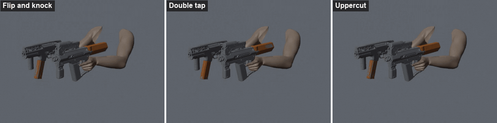
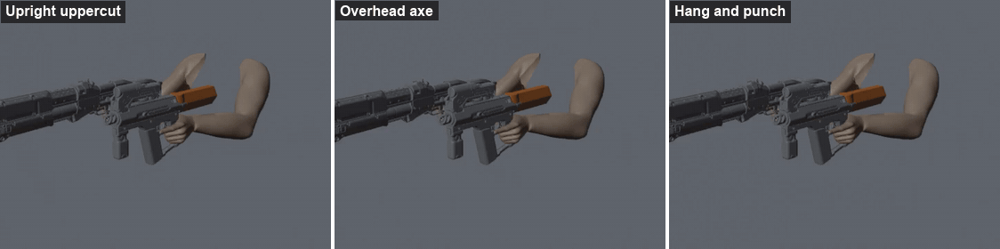
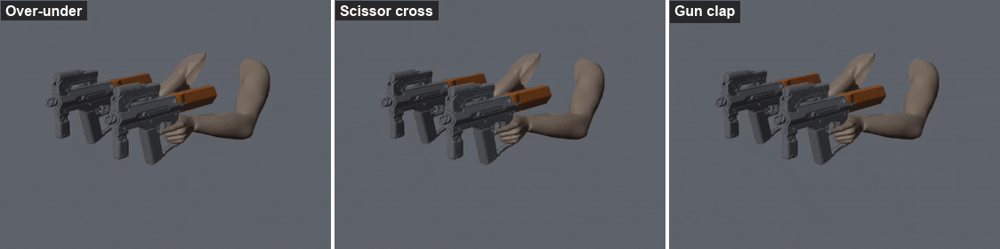

# Changelog

## 3.0.1 (2026-11-08)

- Fix: at the end of a top-magazine reload the arms held still for a moment, then twitched into the dual-wield stance. They now blend into it while the guns come back up.

## 3.0.0 (2026-11-08)

All new custom animations: top-magazine reloads for the Shingen.

- A dual-wielded Shingen reloads two-handed: the other hand, still holding its gun, knocks the top magazine out, both guns go down while the new magazine goes in, and both come back up. Three animations, picked at random each reload (flip and knock, double tap, uppercut), for the Shingen in either hand and for male and female V. The striking gun's path is adjusted to the partner gun's size (compact, standard or long).

  

- With a long shotgun in the other hand (Carnage, Tactician, Zhuo, Igla, Testera, Satara), three animations made for it, picked at random (upright uppercut, overhead axe, hang and punch), so the shotgun never swings across the face.

  

- If the other gun needs a reload too (asked for together, or empty), it reloads in the same down time, and both guns stay down until it is done, the last shell of a shell-by-shell shotgun included.
- Two Shingens reload together with one of three paired animations (over-under, scissor cross, gun clap); both magazines are knocked out and both guns refill.

  

- The magazine stays seated until the other gun hits it, then flies off along the hit and falls: while dual-wielded, the Shingen's magazine plays its own animation for each reload instead of the game's, which unlatches it before the hit.
- The arms ease into the normal dual-wield stance as the guns come back up, with no jump when the reload ends.
- Neither gun fires during a two-handed reload, and the other gun's reload waits until it is done (a reload asked for meanwhile starts right after).
- Fix: hard landings with a pair of SMGs or shotguns had no camera dip or hand brace and left the arms stuck.
- Fix: a holstered pair showed stretched or missing arms when looking down.

## 2.1.2 (2026-11-06)

- Fix: Heywood Hurricane (Double Trouble level 2) stopped after one shot with a pair of Carnages. Each Carnage shot briefly staggers V, which ended it; it now keeps firing both guns for its full duration. Other pairs are unchanged.

## 2.1.1 (2026-11-06)

- Double Trouble's weapon box now says Gorilla Arms extend "this effect" to SMGs and Shotguns.

## 2.1.0 (2026-11-06)

In-game settings with [Mod Settings](https://www.nexusmods.com/cyberpunk2077/mods/4885), independent firing and Body scaling.

- Settings: pair SMGs, magazine shotguns, shell-by-shell shotguns and double-barrels or not; fire both guns at once or alternate them; remove Double Trouble's 37.5% damage penalty; load all shells of a shell-by-shell shotgun at once. Without Mod Settings, the defaults apply.
- Independent firing (setting, off by default): the left mouse button fires the left gun, the right mouse button the right gun (left and right trigger on a controller). Aiming moves to its own key, mouse button 4 or the left stick click by default, rebindable in Key Bindings with [Unified Keybinds](https://www.nexusmods.com/cyberpunk2077/mods/37156). Needs [Input Loader](https://www.nexusmods.com/cyberpunk2077/mods/4575). Each gun's own button also cuts its shell-by-shell reload short.
- Body scaling: every Body point gives dual-wielded SMGs and shotguns -2% recoil, +2% fire rate and +3% reload speed (-40%, +40% and +60% at Body 20). Each can be changed or turned off in the settings. Raising Body applies to drawn guns right away.
- The Gorilla Arms tooltip shows the Body scaling in its Body Attuned block.

## 2.0.1 (2026-11-06)

- Fixed a crash when a dual-wielded SMG or shotgun reloads, most often when both guns reload at once. The reload animations pointed at fallback poses of other clips.

## 2.0.0 (2026-11-06)

Dual-wielded SMGs and shotguns get their own reload animations, timing and sounds. Needs [ArchiveXL](https://www.nexusmods.com/cyberpunk2077/mods/4198) now.

- Custom one-handed reload animations for dual-wielded SMGs and shotguns, for male and female V, made from the game's pistol dual-wield reload. The gun tips up while the magazine drops, goes down out of view, and rises back once its ammo is in. Shell-by-shell shotguns go straight down. In 1.0.1 the right gun played its two-handed reload, which swings the gun across the screen.
- Each hand reloads on its own: only the gun that needs ammo goes down, and the other can keep firing. In 1.0.1 the left gun's reload didn't animate and the right gun's moved both arms.
- Reload timing from each gun's live reload stats, so mixed pairs (SMG + shotgun, pistol + SMG) each time themselves. The rise waits for that gun's ammo, so the magazine no longer floats into the gun.
- Shell-by-shell shotguns stay down for the whole reload and load one shell at a time, at the times a single shotgun would (including the gap between shells and the longer first shell from empty). The ammo counter fills shell by shell, and firing mid-reload keeps the loaded shells.
- Both guns play their own reload sounds, timed to their own reloads. In 1.0.1 the left gun's reload had no animation, and so no sound.
- The dual-wield ammo counter no longer cuts off the left gun's count when both guns have long icons.

## 1.0.1 (2026-10-31)

- Renamed from Gorilla Grip to Gorilla Akimbo: files now go to `r6/scripts/GorillaAkimbo` and `r6/tweaks/GorillaAkimbo`. No gameplay changes.
- Manual installs: delete the old `r6/scripts/GorillaGrip` and `r6/tweaks/GorillaGrip` folders, or both versions load.

## 1.0.0 (2026-10-31)

- First release for Cyberpunk 2077 2.5.
- Gorilla Arms make SMGs and shotguns dual-wieldable with Double Trouble.
- Tooltip lines on Gorilla Arms and in Double Trouble's weapon box.
