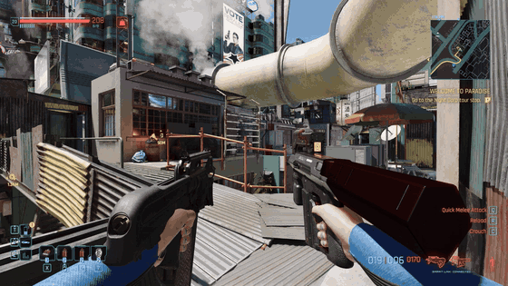
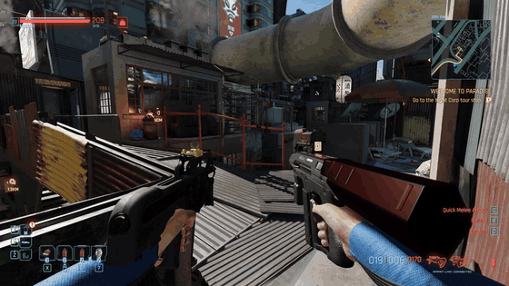
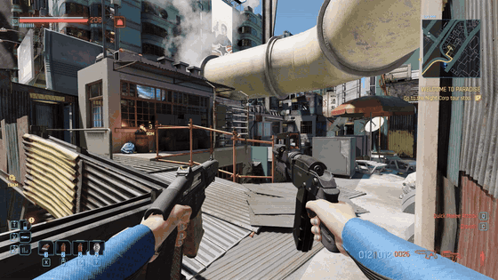
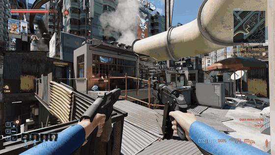

# Gorilla Akimbo

Gorilla Arms let V dual-wield SMGs and shotguns, with their own one-handed reload animations.

The **Double Trouble** perk only pairs pistols and revolvers. **Equip Gorilla Arms** and SMGs and shotguns can be paired too. Without them, everything stays vanilla.

## How it differs from other dual-wield mods

[Dual Wield Anything](https://www.nexusmods.com/cyberpunk2077/mods/35632) and [Expanded Dual Wielding](https://www.nexusmods.com/cyberpunk2077/mods/35626) open dual-wielding to more weapon types and reuse the game's animations for them; both pages say reloads look janky or unusual. Gorilla Akimbo covers only SMGs and shotguns, and gives them:

- One-handed reload animations instead of the game's two-handed ones.
- Independent reloads per hand: one gun reloads while the other keeps firing.
- Reload timing per gun, shell-by-shell loading like vanilla, and each gun's own reload sounds.

## Comparison

Left: without custom animations, the game's two-handed reloads. Right: Gorilla Akimbo's custom animations.

**One gun reloads, the other keeps firing** (Shingen + Pulsar).

| Without custom animations | Gorilla Akimbo |
|---|---|
|  |  |

**Magazine shotguns** (Pozhar + Crusher).

| Without custom animations | Gorilla Akimbo |
|---|---|
|  |  |

## Features

- **Dual-wield SMGs and shotguns** with Gorilla Arms and Double Trouble, including double-barrels and modded weapons of those types. Removing Gorilla Arms unequips the off-hand SMG or shotgun.
- **One-handed reload animations**, for male and female V. The gun tips up while its magazine drops, goes down out of view, and rises once its ammo is in. Shell-fed shotguns go straight down.
- **Independent reloads.** Only the gun that needs ammo goes down; the other can keep firing.
- **Reload timing from each gun's stats**, including perks and weapon mods, so mixed pairs work.
- **Shell-by-shell reloads like vanilla.** Shells load one at a time; firing mid-reload keeps them.
- **Each gun's own reload sounds**, for both guns.
- **Ammo counter fix:** with two long guns, the left gun's count is no longer cut off.
- **Fits the game's UI:** Double Trouble's weapon box and the Gorilla Arms tooltip mention the extension.
- No new perk, nothing in your save. Single-wielded SMGs and shotguns are unchanged.

## Limitations

- The animations are in active development and will be refined further.
- Firing animations are still the game's.
- Only the right gun's reload can be cut short by firing, unless the right gun is empty. Vanilla pistols work the same way.
- Long shotguns (Zhuo, Tactician) swing toward the middle of the screen during the reload.
- Weapons without their own reload sounds (the Guillotine, modded weapons) borrow those of a similar gun.
- Female V's animations haven't been played on a female character yet.
- Photo mode poses hold a single gun.

## Requirements

- Cyberpunk 2077 **2.5**
- [RED4ext](https://www.nexusmods.com/cyberpunk2077/mods/2380), [redscript](https://www.nexusmods.com/cyberpunk2077/mods/1511), [TweakXL](https://www.nexusmods.com/cyberpunk2077/mods/4197), [Codeware](https://www.nexusmods.com/cyberpunk2077/mods/7780), [ArchiveXL](https://www.nexusmods.com/cyberpunk2077/mods/4198)

## Installation

Install with Mod Organizer 2 or Vortex, or extract into the game folder. The files go to:

```
archive/pc/mod/GorillaAkimbo.archive
archive/pc/mod/GorillaAkimbo.archive.xl
r6/scripts/GorillaAkimbo/GorillaAkimbo.reds
r6/scripts/GorillaAkimbo/GorillaAkimboSounds.reds
r6/tweaks/GorillaAkimbo/GorillaAkimbo.yaml
```

Updating from Gorilla Grip by hand: **delete the old** `r6/scripts/GorillaGrip` and `r6/tweaks/GorillaGrip` folders.

## Uninstallation

**Unpair any dual-wielded SMGs or shotguns**, then remove the files above.

## Building

The animations are generated from the game's own files by the scripts in [tools/anim](tools/anim).

## License

MIT, see [LICENSE](LICENSE).
