# Gorilla Akimbo

Gorilla Arms let V dual-wield SMGs, shotguns and assault rifles, with their own one-handed reload animations. Every pistol and revolver can be dual-wielded too.

The **Double Trouble** perk only pairs Power pistols and revolvers. With it, Tech and Smart pistols and Tech revolvers can be paired as well. **Equip Gorilla Arms** and SMGs, shotguns and assault rifles can be paired too.

## How it differs from other dual-wield mods

[Dual Wield Anything](https://www.nexusmods.com/cyberpunk2077/mods/35632) and [Expanded Dual Wielding](https://www.nexusmods.com/cyberpunk2077/mods/35626) open dual-wielding to more weapon types and reuse the game's animations for them; both pages say reloads look janky or unusual. Gorilla Akimbo covers SMGs, shotguns and assault rifles, and gives them:

- One-handed reload animations instead of the game's two-handed ones.
- Independent reloads per hand: one gun reloads while the other keeps firing.
- Reload timing per gun, shell-by-shell loading like vanilla, and each gun's own reload sounds.

## Comparison

**One gun reloads, the other keeps firing** (Shingen + Pulsar).

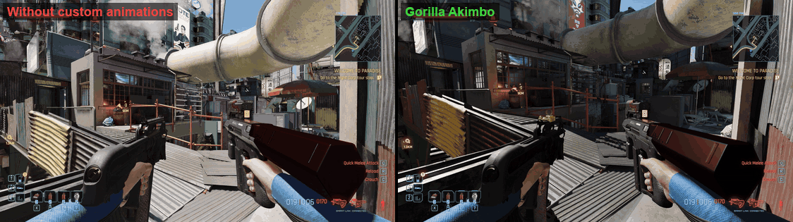

**Magazine shotguns** (Pozhar + Crusher).

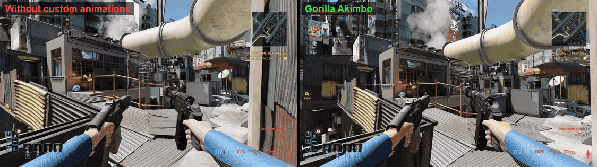

<sub>The animations are in active development and will be refined further.</sub>

## Features

- **Dual-wield SMGs, shotguns and assault rifles** with Gorilla Arms and Double Trouble, including double-barrels and modded weapons of those types. Removing Gorilla Arms unequips the off-hand gun.

  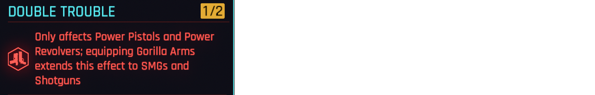

- **Body scaling:** every Body point gives dual-wielded SMGs, shotguns and assault rifles -2% recoil, +2% fire rate and +3% reload speed, shown in the Gorilla Arms' Body Attuned block like the game's attribute bonuses. Each can be changed or turned off in the settings.

  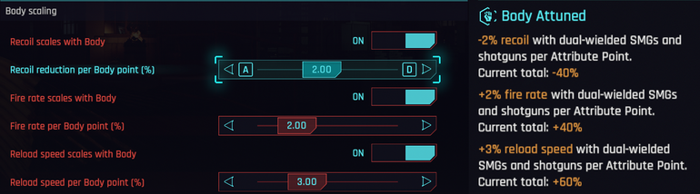

- **One-handed reload animations**, for male and female V. The gun tips up while its magazine drops, goes down out of view, and rises once its ammo is in. Shell-fed shotguns go straight down.
- **Assault rifle reloads made for each rifle's magazine**, three picks per rifle: front-magazine rifles throw the magazine out, shove it out forward or leave it behind and are driven onto a fresh one at the belt, the Masamune throws its magazine out with a nod or a corkscrew roll, or heaves the rifle off it, the Hercules pops its latch and throws or drops the cassette. The magazine has its own animation in each.

  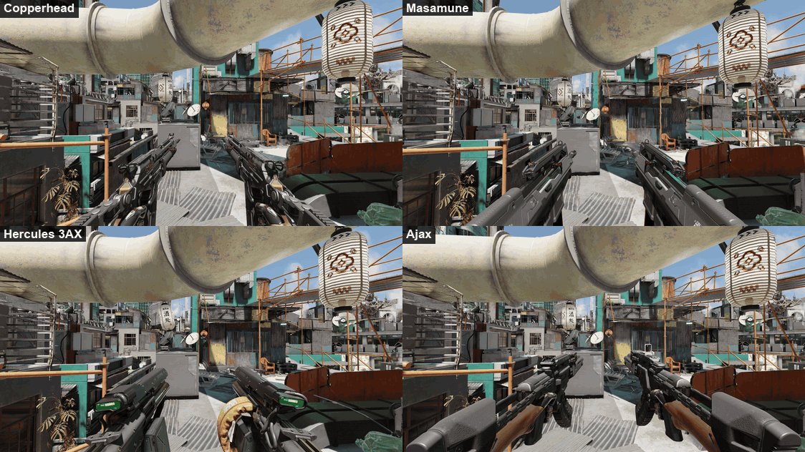

- **Bulky rifles held at the hip** (Masamune, Hercules, Copperhead, Umbra, Sidewinder, Divided We Stand), so a pair doesn't fill the view. Aiming and shots are unchanged.
- **Every pistol and revolver**: Tech and Smart pistols and Tech revolvers pair with Double Trouble alone, with the Lexington's and the Nova's dual-wield animations.

  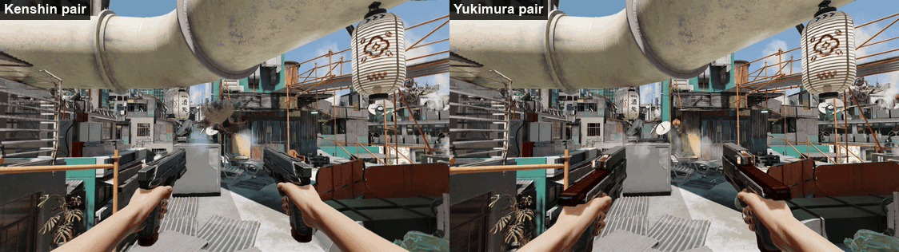

- **Independent reloads.** Only the gun that needs ammo goes down; the other can keep firing.
- **Reload timing calculated from each gun's stats**, including perks and weapon mods, so mixed pairs work.
- **Shell-by-shell reloads like vanilla.** Shells load one at a time; firing mid-reload keeps them.
- **Each gun's own reload sounds**, for both guns.
- **Ammo counter fix:** with two long guns, the left gun's count is no longer cut off.
- **Lowered stance in safe zones**, for male and female V: low ready for SMGs, short shotguns and assault rifles, high port for long shotguns, each hand by its own gun. Firing raises the guns; they lower again after a while.

  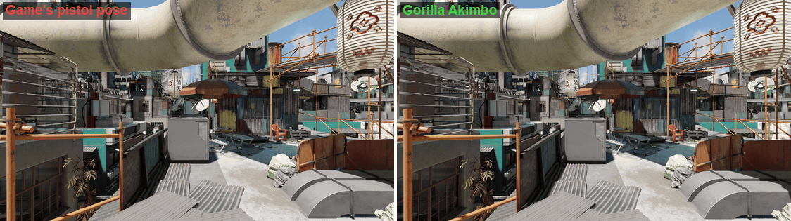

- **Grenades:** the right gun stays up and can keep firing while the left hand throws, quick or charged. The left gun comes back on its own.

  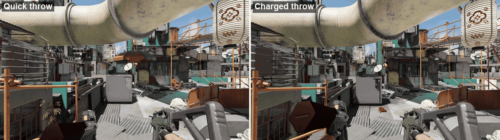

- **Carrying a body:** with Gorilla Arms, SMGs, shotguns and assault rifles are held in the right hand while V carries a body, like pistols and revolvers in vanilla, and fire and reload one-handed. The left gun comes back when the body is put down. The mouse wheel switches between these guns during the carry, paired or not. The game's own requirement for shooting while carrying a body still applies.

  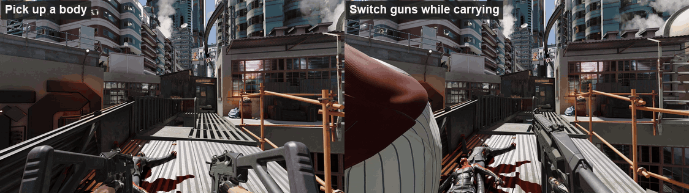

- **Independent firing** (setting): the left mouse button fires the left gun, the right mouse button the right gun (each trigger on a controller). Aiming moves to its own key, mouse button 4 by default, rebindable in Key Bindings with [Unified Keybinds](https://www.nexusmods.com/cyberpunk2077/mods/37156). A gun's own button also cuts its shell-by-shell reload short.

  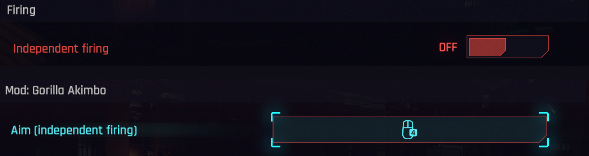

- **Key hints:** with independent firing on, the input hints show which button fires which gun and the aim key, with your own keys on keyboard or controller.

  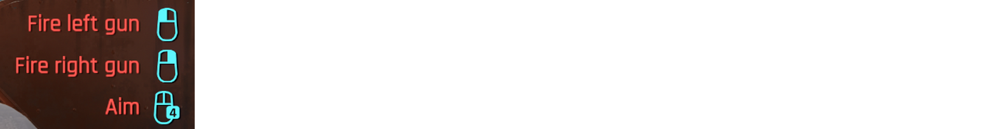

- **Smart Link on both guns** (setting, on by default): bullets from a Smart gun in the left hand go to the targets Smart Link locks, like the right gun's. In vanilla only the right gun's bullets track.

  


## Settings

Set it up in game with [Mod Settings](https://www.nexusmods.com/cyberpunk2077/mods/4885). Without it, the defaults apply.

- **Weapons:** which SMGs and shotguns Gorilla Arms let you pair, by type (Power, Smart, Tech) and, for shotguns, by how they reload.

  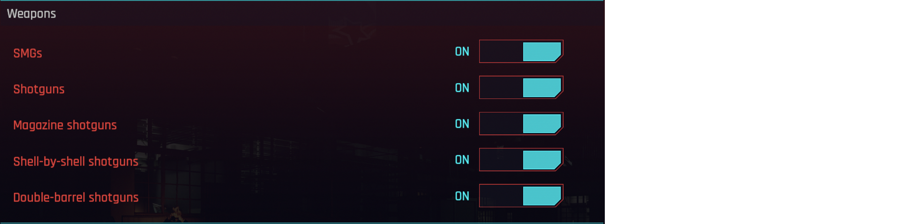

- **Assault rifles:** which assault rifles Gorilla Arms let you pair, all or by type (Power, Smart).

  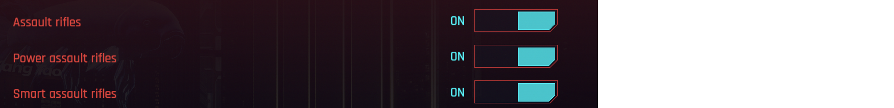

- **Pistols and revolvers:** which pistols and revolvers the game leaves out you can pair (Tech and Smart pistols, Tech revolvers).

  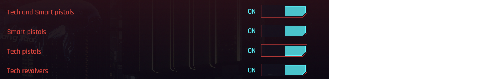

- **Firing:** how one fire button uses both guns: as in vanilla, both at once, or taking turns.

  

- **Remove Double Trouble's damage penalty:** both guns keep their full damage (Double Trouble normally cuts it by 37.5%).

  

- **Shell-by-shell shotgun reload:** one shell at a time as in vanilla, or every shell in the time of one.

  

## Limitations

- Without independent firing, only the right gun's reload can be cut short by firing, unless the right gun is empty. Vanilla pistols work the same way.
- Long shotguns (Zhuo, Tactician) swing toward the middle of the screen during the reload.
- Photo mode poses hold a single gun.
- The animations are first-person only. Third-person mods like Immersive Third Person switch to first person while a weapon is drawn.
- Independent firing hasn't been tested with a controller.

## Requirements

- Cyberpunk 2077 **2.5**
- [RED4ext](https://www.nexusmods.com/cyberpunk2077/mods/2380), [redscript](https://www.nexusmods.com/cyberpunk2077/mods/1511), [TweakXL](https://www.nexusmods.com/cyberpunk2077/mods/4197), [Codeware](https://www.nexusmods.com/cyberpunk2077/mods/7780), [ArchiveXL](https://www.nexusmods.com/cyberpunk2077/mods/4198)
- [Mod Settings](https://www.nexusmods.com/cyberpunk2077/mods/4885) for the settings (without it, the defaults apply)
- [Input Loader](https://www.nexusmods.com/cyberpunk2077/mods/4575) and [Unified Keybinds](https://www.nexusmods.com/cyberpunk2077/mods/37156) for independent firing's aim key

## Installation

Install with Mod Organizer 2 or Vortex, or extract into the game folder. The files go to:

```
archive/pc/mod/GorillaAkimbo.archive
archive/pc/mod/GorillaAkimbo.archive.xl
archive/pc/mod/GorillaAkimboLowered.archive
archive/pc/mod/GorillaAkimboLowered.archive.xl
archive/pc/mod/GorillaAkimboRifles.archive
archive/pc/mod/GorillaAkimboRifles.archive.xl
r6/config/modkeybinds/GorillaAkimbo.json
r6/input/GorillaAkimbo.xml
r6/scripts/GorillaAkimbo/GorillaAkimbo.reds
r6/scripts/GorillaAkimbo/GorillaAkimboGadget.reds
r6/scripts/GorillaAkimbo/GorillaAkimboGuns.reds
r6/scripts/GorillaAkimbo/GorillaAkimboHints.reds
r6/scripts/GorillaAkimbo/GorillaAkimboIndependent.reds
r6/scripts/GorillaAkimbo/GorillaAkimboSettings.reds
r6/scripts/GorillaAkimbo/GorillaAkimboSmart.reds
r6/scripts/GorillaAkimbo/GorillaAkimboSounds.reds
r6/scripts/GorillaAkimbo/GorillaAkimboTopMag.reds
r6/scripts/GorillaAkimbo/GorillaAkimboVanilla.reds
r6/tweaks/GorillaAkimbo/GorillaAkimbo.yaml
```

*Formerly Gorilla Grip.* Updating by hand from Gorilla Grip: **delete the old** `r6/scripts/GorillaGrip` and `r6/tweaks/GorillaGrip` folders.

## Uninstallation

**Unpair any dual-wielded SMGs, shotguns, assault rifles, Tech or Smart pistols and Tech revolvers**, then remove the files above.

## Credits

- Inspired by Rebecca in *Cyberpunk: Edgerunners* (Studio Trigger / CD PROJEKT RED).
- psiberx for [Codeware](https://www.nexusmods.com/cyberpunk2077/mods/7780), [TweakXL](https://www.nexusmods.com/cyberpunk2077/mods/4197) and [ArchiveXL](https://www.nexusmods.com/cyberpunk2077/mods/4198), jac3km4 for [redscript](https://www.nexusmods.com/cyberpunk2077/mods/1511), WopsS for [RED4ext](https://www.nexusmods.com/cyberpunk2077/mods/2380), jackhumbert for [Mod Settings](https://www.nexusmods.com/cyberpunk2077/mods/4885) and [Input Loader](https://www.nexusmods.com/cyberpunk2077/mods/4575), and the [WolvenKit](https://github.com/WolvenKit/WolvenKit) team.

## Building

The animations are generated from the game's own files by the scripts in [tools/anim](tools/anim).

## License

MIT, see [LICENSE](LICENSE).
