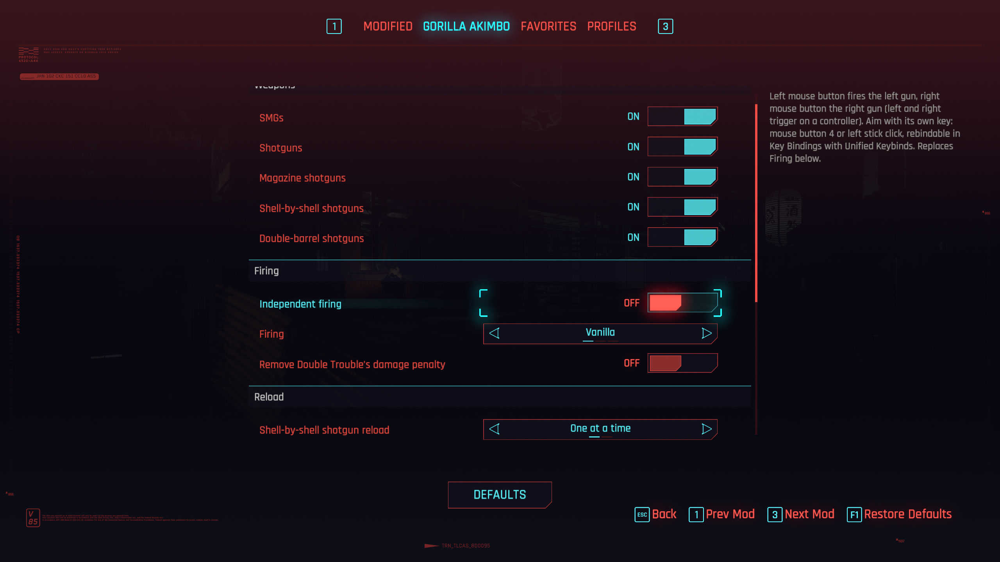
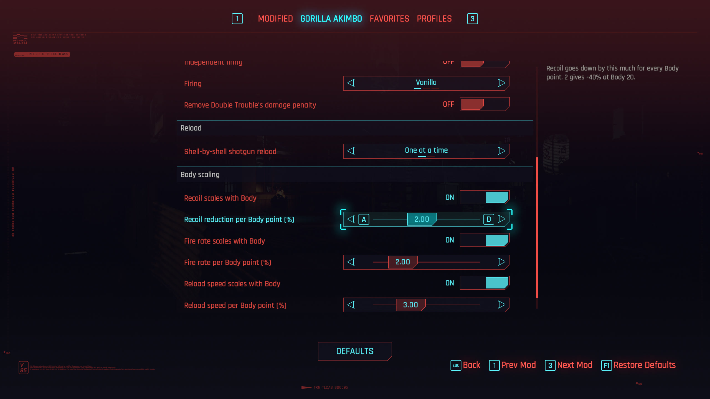
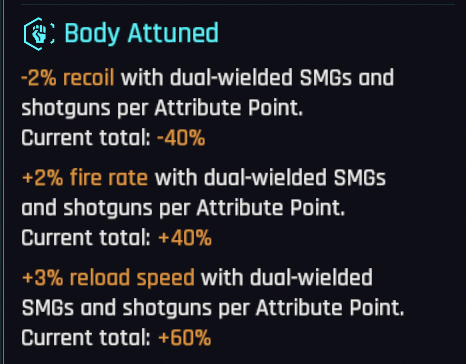
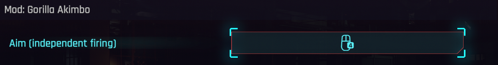

# Gorilla Akimbo

Gorilla Arms let V dual-wield SMGs and shotguns, with their own one-handed reload animations.

The **Double Trouble** perk only pairs pistols and power revolvers. **Equip Gorilla Arms** and SMGs and shotguns can be paired too. Without them, everything stays vanilla.

## How it differs from other dual-wield mods

[Dual Wield Anything](https://www.nexusmods.com/cyberpunk2077/mods/35632) and [Expanded Dual Wielding](https://www.nexusmods.com/cyberpunk2077/mods/35626) open dual-wielding to more weapon types and reuse the game's animations for them; both pages say reloads look janky or unusual. Gorilla Akimbo covers only SMGs and shotguns, and gives them:

- One-handed reload animations instead of the game's two-handed ones.
- Independent reloads per hand: one gun reloads while the other keeps firing.
- Reload timing per gun, shell-by-shell loading like vanilla, and each gun's own reload sounds.

## Comparison

**One gun reloads, the other keeps firing** (Shingen + Pulsar).


**Magazine shotguns** (Pozhar + Crusher).


<sub>The animations are in active development and will be refined further.</sub>

## Settings

Everything can be set in game with [Mod Settings](https://www.nexusmods.com/cyberpunk2077/mods/4885): which weapons can be paired, how the guns fire, Double Trouble's damage penalty, shell reloads and the Body scaling.





**Body scaling.** Every Body point gives dual-wielded SMGs and shotguns less recoil, a higher fire rate and faster reloads, shown in the Gorilla Arms' Body Attuned block like the game's attribute bonuses.



**Independent firing.** The left mouse button fires the left gun, the right mouse button the right gun. Aiming moves to its own key, mouse button 4 by default, rebindable in Key Bindings with [Unified Keybinds](https://www.nexusmods.com/cyberpunk2077/mods/37156).



## Features

- **Dual-wield SMGs and shotguns** with Gorilla Arms and Double Trouble, including double-barrels and modded weapons of those types. Removing Gorilla Arms unequips the off-hand SMG or shotgun.
- **One-handed reload animations**, for male and female V. The gun tips up while its magazine drops, goes down out of view, and rises once its ammo is in. Shell-fed shotguns go straight down.
- **Independent reloads.** Only the gun that needs ammo goes down; the other can keep firing.
- **Reload timing calculated from each gun's stats**, including perks and weapon mods, so mixed pairs work.
- **Shell-by-shell reloads like vanilla.** Shells load one at a time; firing mid-reload keeps them.
- **Each gun's own reload sounds**, for both guns.
- **Independent firing** (setting): each mouse button fires one gun (each trigger on a controller), and aiming moves to its own rebindable key. A gun's own button also cuts its shell-by-shell reload short.
- **Body scaling:** -2% recoil, +2% fire rate and +3% reload speed per Body point for dual-wielded SMGs and shotguns, shown on the Gorilla Arms tooltip. Adjustable or off in the settings.
- **More settings:** pair SMGs, magazine shotguns, shell-by-shell shotguns and double-barrels or not; fire both guns at once or alternate them; remove Double Trouble's 37.5% damage penalty; load all shells at once.
- **Ammo counter fix:** with two long guns, the left gun's count is no longer cut off.
- **Fits the game's UI:** the **Double Trouble** weapon box and the **Gorilla Arms** tooltip mention the extension, and the tooltip shows the Body scaling.
- No new perk, nothing in your save. Single-wielded SMGs and shotguns are unchanged.

## Limitations

- Without independent firing, only the right gun's reload can be cut short by firing, unless the right gun is empty. Vanilla pistols work the same way.
- Long shotguns (Zhuo, Tactician) swing toward the middle of the screen during the reload.
- Photo mode poses hold a single gun.
- Independent firing hasn't been tested with a controller.

## Requirements

- Cyberpunk 2077 **2.5**
- [RED4ext](https://www.nexusmods.com/cyberpunk2077/mods/2380), [redscript](https://www.nexusmods.com/cyberpunk2077/mods/1511), [TweakXL](https://www.nexusmods.com/cyberpunk2077/mods/4197), [Codeware](https://www.nexusmods.com/cyberpunk2077/mods/7780), [ArchiveXL](https://www.nexusmods.com/cyberpunk2077/mods/4198)
- [Mod Settings](https://www.nexusmods.com/cyberpunk2077/mods/4885) for the settings (without it, the defaults apply)
- [Input Loader](https://www.nexusmods.com/cyberpunk2077/mods/4575) and [Unified Keybinds](https://www.nexusmods.com/cyberpunk2077/mods/37156) for independent firing's aim key

## Installation

Install with Mod Organizer 2 or Vortex, or extract into the game folder. The files go to:

```
archive/pc/mod/GorillaAkimbo.archive
archive/pc/mod/GorillaAkimbo.archive.xl
r6/config/modkeybinds/GorillaAkimbo.json
r6/input/GorillaAkimbo.xml
r6/scripts/GorillaAkimbo/GorillaAkimbo.reds
r6/scripts/GorillaAkimbo/GorillaAkimboIndependent.reds
r6/scripts/GorillaAkimbo/GorillaAkimboSettings.reds
r6/scripts/GorillaAkimbo/GorillaAkimboSounds.reds
r6/tweaks/GorillaAkimbo/GorillaAkimbo.yaml
```

*Formerly Gorilla Grip.* Updating by hand from Gorilla Grip: **delete the old** `r6/scripts/GorillaGrip` and `r6/tweaks/GorillaGrip` folders.

## Uninstallation

**Unpair any dual-wielded SMGs or shotguns**, then remove the files above.

## Credits

- Inspired by Rebecca in *Cyberpunk: Edgerunners* (Studio Trigger / CD PROJEKT RED).
- psiberx for [Codeware](https://www.nexusmods.com/cyberpunk2077/mods/7780), [TweakXL](https://www.nexusmods.com/cyberpunk2077/mods/4197) and [ArchiveXL](https://www.nexusmods.com/cyberpunk2077/mods/4198), jac3km4 for [redscript](https://www.nexusmods.com/cyberpunk2077/mods/1511), WopsS for [RED4ext](https://www.nexusmods.com/cyberpunk2077/mods/2380), jackhumbert for [Mod Settings](https://www.nexusmods.com/cyberpunk2077/mods/4885) and [Input Loader](https://www.nexusmods.com/cyberpunk2077/mods/4575), and the [WolvenKit](https://github.com/WolvenKit/WolvenKit) team.

## Building

The animations are generated from the game's own files by the scripts in [tools/anim](tools/anim).

## License

MIT, see [LICENSE](LICENSE).
