# Gorilla Akimbo

Gorilla Arms let V dual-wield SMGs and shotguns, with their own one-handed reload animations.

Patch 2.5 added dual-wielding through the **Double Trouble** perk (Cool), limited to pistols and revolvers. Gorilla Akimbo extends it: while **Gorilla Arms** are equipped, their reinforced grip actuators steady heavier guns one-handed, so SMGs and shotguns can be paired too. Without Gorilla Arms, everything stays vanilla.

Since 2.0.0, dual-wielded SMGs and shotguns no longer borrow the game's two-handed reloads. Each gun has its own arm animation, reloads on its own timing, and plays its own reload sounds.

## Before and after

Every clip: V shoots a few rounds from both guns, then reloads. Left column is 1.0.1, right column is 2.0.0, same spot, same weapons.

**Two SMGs** (Shingen + Saratoga). Before: the right gun plays its two-handed reload across the screen and the left gun doesn't animate. After: each gun tips up while its magazine drops, goes down out of view, and comes back up once its own reload is done.

| Before (1.0.1) | After (2.0.0) |
|---|---|
| 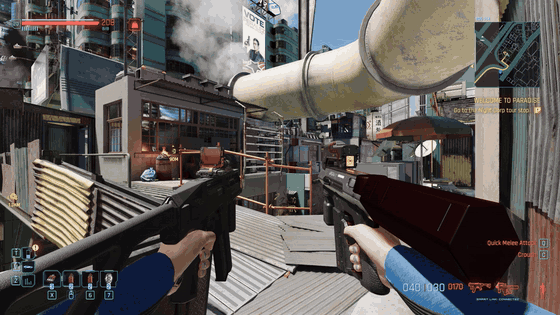 | 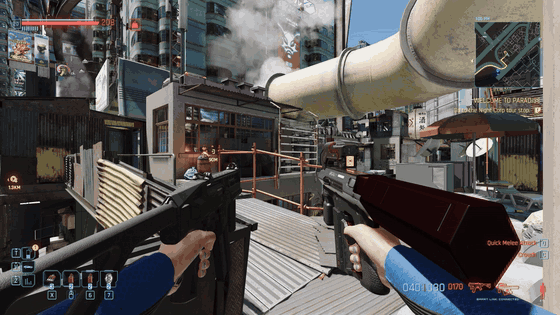 |

**One gun reloads, the other keeps firing** (Shingen + Pulsar). The Shingen runs dry first. Before: its two-handed reload swings through the middle of the screen. After: only the Shingen goes down while the Pulsar keeps shooting, then the Pulsar reloads on its own when it runs dry.

| Before (1.0.1) | After (2.0.0) |
|---|---|
|  |  |

**Shell-fed shotguns** (Carnage + Tactician). After: both go down and load their shells one at a time; the ammo counter fills shell by shell.

| Before (1.0.1) | After (2.0.0) |
|---|---|
| 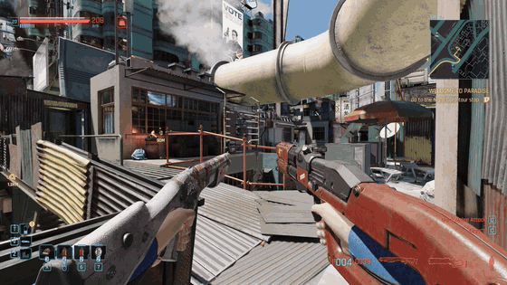 | 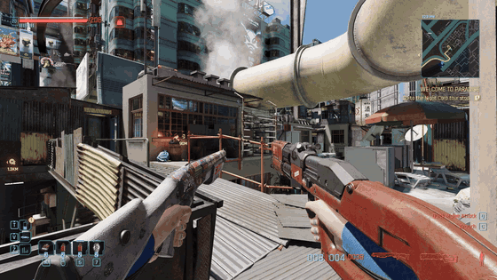 |

**Magazine shotguns** (Pozhar + Crusher). After: each gun tips up while its magazine slides out and falls, then goes down.

| Before (1.0.1) | After (2.0.0) |
|---|---|
|  |  |
| 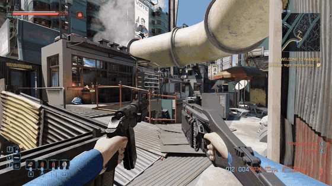 | 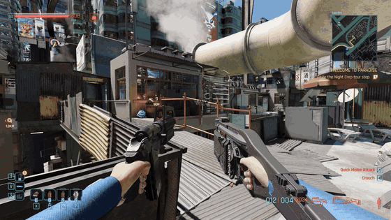 |

**Double-barrel shotguns** (Igla + Testera, Palica + Satara).

| Before (1.0.1) | After (2.0.0) |
|---|---|
| 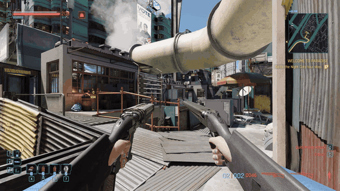 | 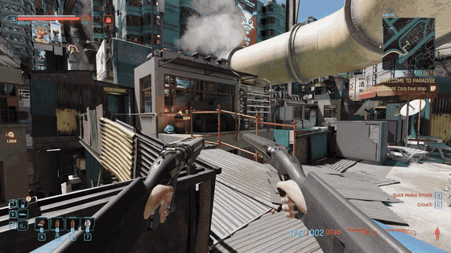 |
| 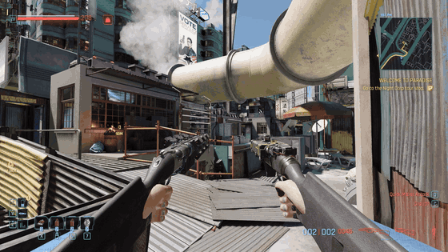 | 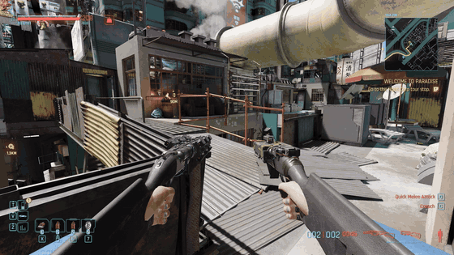 |

**Mixed pairs**, each gun with its own reload: a pistol + an SMG (the pistol keeps its vanilla reload), an SMG + a shotgun, and a magazine shotgun + a shell-fed one.

| Before (1.0.1) | After (2.0.0) |
|---|---|
| 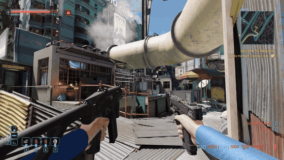 | 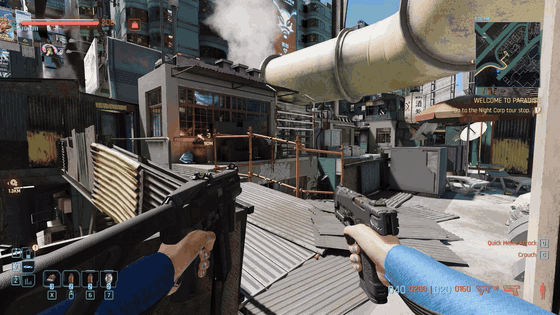 |
| 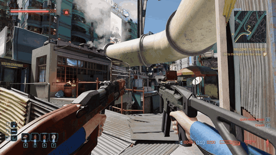 | 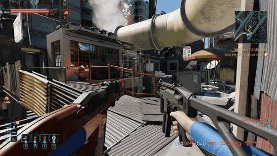 |
| 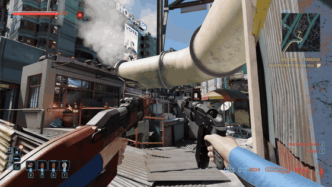 | 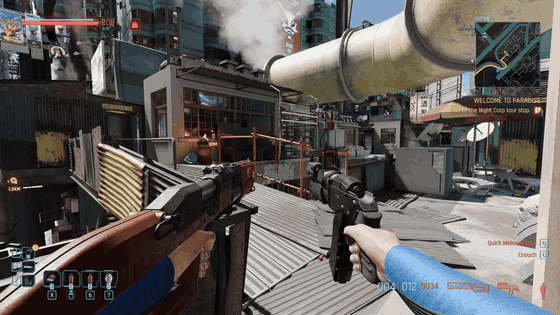 |

**The dual-wield ammo counter** (Carnage + Tactician). Before: two long weapon icons push the left gun's count out of the HUD. After: both counts show, at the game's own icon sizes.

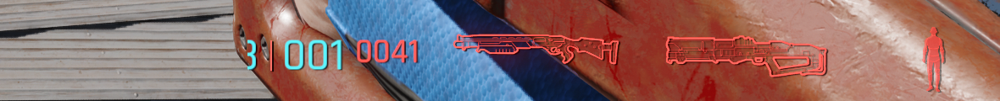
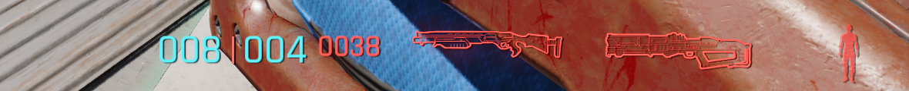

## Features

- **Dual-wield SMGs and shotguns** with Gorilla Arms and Double Trouble, including double-barrel shotguns and modded weapons of those types. Without Gorilla Arms, only pistols and revolvers can be dual-wielded, as in vanilla. Removing Gorilla Arms unequips the off-hand SMG or shotgun.
- **Custom one-handed reload animations** for every dual-wielded SMG and shotgun, built from the game's own pistol dual-wield reload:
  - The gun tips up slowly (half the pistol's lift, so long guns stay on their side) while its magazine drops out, at a speed picked per gun from its own reload animation so the gun only goes down once the magazine has fallen clear, then goes down out of view with the muzzle tipped down.
  - It stays out of view until its ammo is in, then rises the way the pistol's empty reload does: muzzle up, a small overshoot, then it settles.
  - Shell-by-shell shotguns (Carnage, Tactician) skip the tip-up and go straight down, since they have no magazine.
  - Male and female V each get their own clips, made from the game's male and female sets.
- **Each hand reloads on its own.** Only the gun that needs ammo goes down; the other stays up and can keep firing. In 1.0.1 the left gun didn't animate at all and the right gun's reload moved both arms.
- **Reload timing from each gun's live stats.** The reload and empty-reload times include perks and weapon mods, so any pair (SMG + SMG, shotgun + shotgun, SMG + shotgun, pistol + SMG) times itself. The rise starts when that gun's ammo is in, so the magazine never floats into the gun on the way up.
- **Shell-by-shell reloads like vanilla.** The gun stays down for the whole reload while shells land one at a time on the ammo counter, at the same times a single shotgun's reload would load them (reload time plus the gap between shells, and the longer first shell from empty). Firing mid-reload keeps the shells already loaded.
- **Each gun's own reload sounds, for both guns.** Mag out, mag in, handle pull, shell in and so on, taken from each weapon's two-handed reload and timed to its reload. Two guns reloading together overlap. In 1.0.1 the left gun's reload had no animation, and so no sound.
- **Ammo counter fixed for two long guns.** The left gun's count is no longer cut off; the icons keep the game's sizes.
- **Fits the game's UI:**
  - Double Trouble's weapon box reads *"Only affects Power Pistols and Power Revolvers; equipping Gorilla Arms extends this to SMGs and Shotguns"*.
  - Gorilla Arms get a tooltip line: *"Reinforced grip actuators steady SMGs and shotguns one-handed: with Double Trouble, they can be dual-wielded."*
- No new perk and nothing written to your save. Single-wielded SMGs and shotguns keep their vanilla animations.

## How it differs from other dual-wield mods

[Dual Wield Anything](https://www.nexusmods.com/cyberpunk2077/mods/35632) and [Expanded Dual Wielding](https://www.nexusmods.com/cyberpunk2077/mods/35626) open dual-wielding to more weapon types, and Expanded Dual Wielding adds control options such as firing each gun on its own button. Both reuse the game's existing animations for those weapons, and both pages say the result looks janky or that reloads may look unusual.

Gorilla Akimbo covers fewer weapons (SMGs and shotguns, tied to Gorilla Arms) and makes them look right:

- Its own one-handed arm animations for reloads, instead of the two-handed ones.
- Each hand reloads on its own, so one gun can reload while the other fires.
- Reload timing per gun from its live stats, shell-by-shell loading like vanilla, and each gun's own reload sounds.
- The dual-wield ammo counter fix.

Use one dual-wield mod at a time: they all change which weapons can be paired.

## Requirements

- Cyberpunk 2077 **2.5**
- [RED4ext](https://www.nexusmods.com/cyberpunk2077/mods/2380)
- [redscript](https://www.nexusmods.com/cyberpunk2077/mods/1511)
- [TweakXL](https://www.nexusmods.com/cyberpunk2077/mods/4197)
- [Codeware](https://www.nexusmods.com/cyberpunk2077/mods/7780)
- [ArchiveXL](https://www.nexusmods.com/cyberpunk2077/mods/4198) (new in 2.0.0)

## Installation

Extract the archive into the Cyberpunk 2077 game folder, or install it with Mod Organizer 2 or Vortex. The files go to:

```
archive/pc/mod/GorillaAkimbo.archive
archive/pc/mod/GorillaAkimbo.archive.xl
r6/scripts/GorillaAkimbo/GorillaAkimbo.reds
r6/scripts/GorillaAkimbo/GorillaAkimboSounds.reds
r6/tweaks/GorillaAkimbo/GorillaAkimbo.yaml
```

Updating from 1.0.0 by hand: delete the old `r6/scripts/GorillaGrip` and `r6/tweaks/GorillaGrip` folders first.

## Uninstallation

Unpair any dual-wielded SMGs or shotguns first, then remove the files above. Nothing is written to your save.

## Limitations

- Firing animations (recoil, shotgun pumping) are still the game's pistol dual-wield ones.
- While dual-wielding, only the right gun's reload can be cut short by firing, unless the right gun is empty. The base game does the same with pistols.
- Long shotguns (Zhuo, Tactician) swing toward the middle of the screen at the top of the tip-up and the rise.
- Weapons without reload sounds of their own in the game files (the Guillotine, modded weapons) use another gun of their type: Saratoga for SMGs, Carnage for shell-fed shotguns, Crusher for magazine shotguns, Igla for double-barrels.
- Female V's clips are built and load in the game, but haven't been played on a female character yet.
- Double Trouble's own bonuses (recoil, spread, Heywood Hurricane) follow the game's rules.
- Photo mode's weapon poses hold a single gun, so dual-wielding only shows in gameplay.

## How it works

- **Dual-wielding:** at load, a Codeware `ScriptableTweak` adds the game's `DualWield` tag to every SMG and shotgun record and the tooltip line to Gorilla Arms. A wrap of `gameItemData.CanDualWield` keeps those weapons dual-wieldable only while a `Cyb_StrongArms` item is in the arms cyberware slot.
- **Arm animations:** `GorillaAkimbo.archive` holds the reload clips for each hand, for male and female V. `GorillaAkimbo.archive.xl` adds them to the player's arm animation sets (ArchiveXL) for every SMG and shotgun model, per hand. The clips are generated from the game's Lexington dual-wield sets by the scripts in [tools/anim](tools/anim).
- **Independent hands:** the ranged animation graph animates each hand on its own only when the right hand holds a one-handed weapon. While two guns are held, SMGs and shotguns report the one-handed item type to the animation graph; held alone, they report their own again.
- **Timing:** a wrap of the reload state reads the gun's reload stats, plays the arm clip at the speed that makes the rise start when the ammo lands, and keeps the reload state alive until the rise is done. For shell-by-shell shotguns it runs the game's passes as one reload, loading each shell at the time the game would and keeping the reload interruptible by firing.
- **Sounds:** `GorillaAkimboSounds.reds` lists each weapon's reload sound events (from its two-handed reload clips, generated by `tools/anim/gensounds.py`), keyed by the weapon's audio name. They're played at the clip times scaled by the gun's reload time over its base reload time, as the game would play them.
- **Ammo counter:** the dual-wield HUD element is drawn into a slot as wide as its HUD entry size. A wrap of the weapon roster's `OnInitialize` makes that entry and its root wider to the left; the counter is anchored to the right, so nothing else moves.
- Texts are registered through Codeware's localization system (English).

## License

MIT, see [LICENSE](LICENSE).
